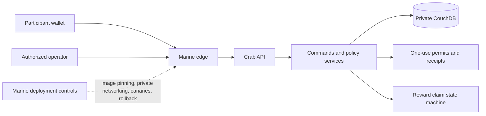

# Case study: governed compute over participant data

DataUnion was built around a difficult infrastructure constraint: useful computation should be possible without treating access to participant data as unrestricted possession. Crab is the control plane for that system. [Marine](https://github.com/DataUnion-app/Marine) supplies its deployment boundary.

This is not an AI training framework or GPU scheduler. It addresses a neighboring set of platform problems: authenticated jobs, immutable inputs, authorization that survives retries, isolated services, observable outcomes, and value returned to the people whose data makes computation useful.

## System boundary

Routes translate HTTP requests. Commands and policy services decide whether an operation is allowed. Data-access objects own persistence and conflict handling. That separation matters because moving policy into routes or database helpers makes it much harder to prove that every entry point enforces the same rules.

## Authorization is evidence, not a boolean

A consent flag is insufficient once a job can outlive a request or be retried by another process. Crab binds sensitive study operations to explicit evidence:

- an operator must be allowed for the deployment;
- a short-lived challenge binds the proposed operation to immutable digests;
- a signed, one-use permit authorizes the exact action rather than a broad session;
- claiming the permit creates a receipt that binds authorization to the execution and result;
- expired, changed, duplicated, or unknown state fails closed.

The study services own the policy, while the activation DAO makes challenge consumption and permit creation one storage mutation. This avoids the gap where a challenge could be consumed without recording its resulting authorization.

The first production deployment was health-oriented, so some package and contract names retain that domain. The reusable idea is the lifecycle: proposal, review, immutable release, authorization, execution receipt, and privacy-limited result.

## Rewards cross a non-transactional boundary

Reward transfers span a database and a blockchain; they cannot share one atomic transaction. A timeout can therefore mean either “nothing happened” or “the transfer succeeded but the response was lost.” Blind retrying risks paying twice.

Crab keeps payout inputs server-owned, creates a durable claim before transfer, records the chain result, and blocks unresolved attempts for reconciliation. Optional client commitments detect a changed reward preview without allowing the client to choose the wallet, amount, or eligible records. Successful transfers can repair an interrupted local projection without issuing another payment.

This pattern applies beyond tokens: any job platform that coordinates an external side effect needs durable intent, idempotency, an explicit ambiguous state, and reconciliation rather than optimistic retry.

## Deployment is part of the trust model

Marine treats deployment topology as a security boundary. Only the Nginx edge publishes host ports; storage, queues, and administrative services stay on private networks. Runtime images are supplied by immutable digest, secrets remain outside the repository, and upgrades require backup, canary, and rollback evidence.

Legacy services are available only through an explicit profile. They are not silently started by the current runtime. This keeps compatibility from expanding the default attack surface.

## Where to review the implementation

- Study policy and authorization live under [`commands/dataunions`](commands/dataunions), with persistence and conflict handling under [`dao`](dao).
- Reward calculation, transfer, and reconciliation live under [`commands/rewards`](commands/rewards) and [`dao/rewards_dao.py`](dao/rewards_dao.py).
- HTTP boundaries live under [`routes`](routes); they should remain adapters rather than policy owners.
- The release gate is defined by the [governed verification workflow](.github/workflows/hardened-candidate.yml).
- Deployment invariants and recovery procedure live in Marine's [deployment](https://github.com/DataUnion-app/Marine/tree/main/deployment) guides.

## Verification and limits

At the August 2026 publication gate, Crab passed 438 governed tests in its pinned Python 3.11 container. Marine passed its helper tests, reward-transfer simulation, and base and optional Compose rendering. The exact Python environments had no known dependency vulnerabilities, the runtime image had no fixable high or critical findings, and the curated public histories passed secret scanning.

The public branch begins with a reviewed release cut because the private development history contained operational material and third-party fixtures. It is intentionally a source release, not a rewritten imitation of years of incremental history.

Crab is a mature application with historical modules, not a greenfield example of a modern GPU control plane. It does not implement cluster scheduling, distributed training, model serving, or reinforcement learning. Its relevant contribution is the control-plane reasoning: authorize exact work, bind it to immutable evidence, isolate the runtime, survive ambiguous side effects, and make failure recoverable.
